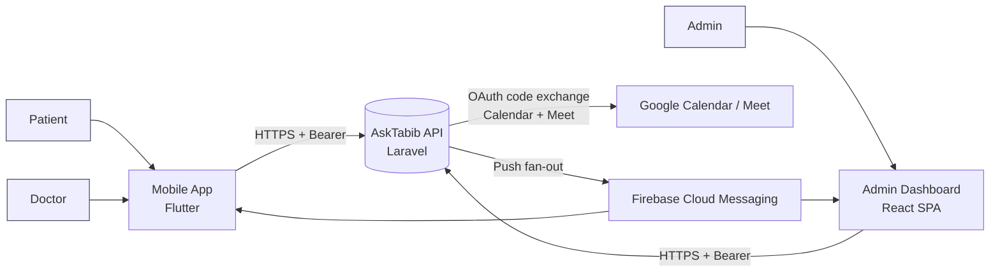
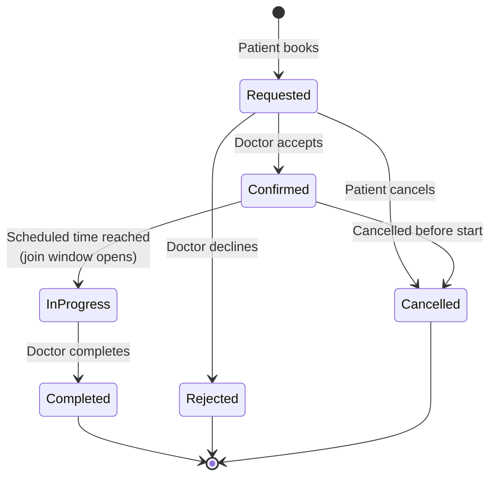
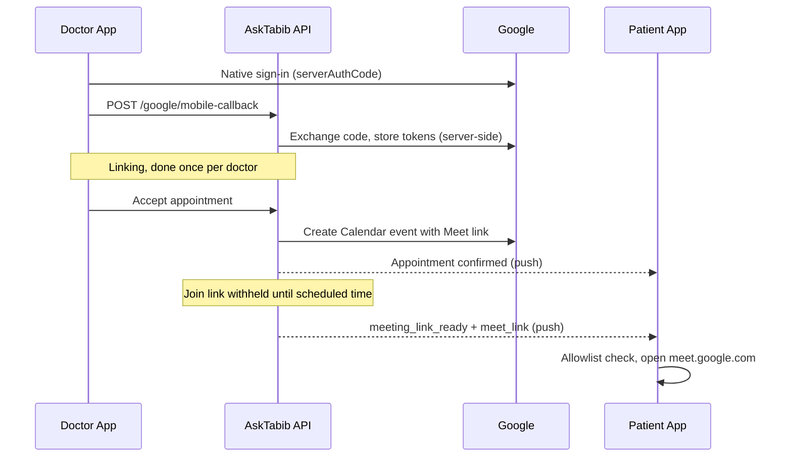

<div align="center">

# AskTabib

### Telehealth Platform: Online Consultations, Scheduling and Real-Time Care Coordination

A dual-role mobile telehealth platform with a web-based administration console, built for patients and doctors across time zones.


</div>

---

## Table of Contents

1. [Overview](#1-overview)
2. [Key Capabilities](#2-key-capabilities)
3. [System Architecture](#3-system-architecture)
4. [Applications](#4-applications)
5. [Appointment Lifecycle](#5-appointment-lifecycle)
6. [Online Consultations (Google Meet)](#6-online-consultations-google-meet)
7. [Real-Time Notifications](#7-real-time-notifications)
8. [Global Time Zone Model](#8-global-time-zone-model)
9. [Security and Privacy](#9-security-and-privacy)
10. [Technology Stack](#10-technology-stack)
11. [Repository Structure](#11-repository-structure)
12. [Getting Started](#12-getting-started)
13. [Configuration](#13-configuration)
14. [Testing and Quality](#14-testing-and-quality)
15. [Deployment](#15-deployment)
16. [Documentation](#16-documentation)
17. [Roadmap](#17-roadmap)
18. [Contributing](#18-contributing)
19. [License and Contact](#19-license-and-contact)

---

## 1. Overview

**AskTabib** ("Ask the Doctor") connects patients with licensed doctors for **online medical consultations**. The platform covers the full care-coordination loop: discovery, booking, doctor acceptance, scheduling, a secure video consultation, follow-up, and platform-level administration.

It consists of three client applications on top of one shared backend:

| Component | Audience | Technology |
|-----------|----------|------------|
| **Patient App** | Patients | Flutter (iOS / Android) |
| **Doctor App** | Doctors | Flutter (same dual-role client) |
| **Admin Dashboard** | Platform operators | React SPA |
| **AskTabib API** | All clients | Laravel REST API (Sanctum) |

Authorization and business rules are enforced **server-side**. Clients apply UX gates and defence-in-depth only.

---

## 2. Key Capabilities

| Capability | Description |
|------------|-------------|
| **Online consultations** | Video sessions through Google Calendar / Meet, with a server-controlled join window |
| **Appointment booking** | Patients browse doctors and book consultation slots |
| **Doctor scheduling** | Doctors manage availability and working schedules |
| **Appointment status management** | Explicit lifecycle: request, accept, confirm, join, complete |
| **Instant push notifications** | FCM delivery in foreground, background and terminated states |
| **Daily medical tips** | Curated health tips shown to patients and managed by admins |
| **Global time zone support** | Per-user IANA time zone; all instants stored in UTC and rendered locally |
| **Multilingual UI** | English, Arabic (RTL) and German |
| **Admin console** | Doctors, specialties, tips, ads, announcements, appointments, finance |
| **Doctor finance** | Per-doctor earnings and settlement summary |

---

## 3. System Architecture

The architecture follows the **C4 model** (Context, Container, Component), with feature-first Clean Architecture on mobile and a feature-sliced SPA on the web.



### Architectural principles

- **Server-authoritative.** RBAC, join-window enforcement, rate limiting and rules live on the API.
- **Secrets stay off devices.** The Google OAuth client secret and Firebase service account exist only on the backend.
- **Single composition root per client.** GetIt (mobile) and a single Axios instance (web).
- **Defence in depth.** Client role gates, URL allowlists and payload sanitization complement server controls.
- **Evolvable.** Each feature is an isolated vertical slice; structural changes are recorded as ADRs.

---

## 4. Applications

### 4.1 Mobile App (Patient and Doctor)

A single Flutter client with **role-aware navigation**: after authentication the user lands on the patient home or the doctor home.

- Style: **feature-first Clean Architecture** (`Presentation -> Domain <- Data`)
- State: **Cubit** (`flutter_bloc`) with immutable states
- DI: **GetIt**
- Errors: `Either<Failure, T>` (`dartz`)
- Localization: ARB (EN / AR / DE)

**Patient capabilities:** discover doctors, book appointments, track status, join consultations at the scheduled time, read daily tips, receive notifications.

**Doctor capabilities:** accept appointments, manage availability, view finance and settlements, link Google Calendar / Meet, complete consultations, manage profile.

### 4.2 Admin Dashboard

A browser console for platform operators, served under `/dashboard/`.

- Style: **feature-sliced SPA** with a thin shared kernel
- Stack: Vite, React 19, Axios, Zustand, i18next, FCM
- Modules: auth, home, appointments, doctors, specialties, tips, ads, announcements, finance
- Access: only sessions with `role === admin` enter the shell

### 4.3 Backend API

A Laravel REST API providing authentication (Sanctum), RBAC, appointment and doctor domains, Google token exchange, Meet provisioning, FCM dispatch and rate limiting.

---

## 5. Appointment Lifecycle



- Appointments are **confirmed on doctor acceptance**, but joining is **not possible until the scheduled start time**.
- Before that, the client shows a disabled *Join* action with the scheduled time (rendered in the user's own time zone).
- Admins can review appointment queues by status from the dashboard.

> Exact state names depend on the API contract. Consult the API documentation for the authoritative list.

---

## 6. Online Consultations (Google Meet)

Consultations use **Google Calendar conference data (Meet)** rather than an embedded WebRTC stack. This favors delivery speed, Google-grade reliability and lower media-infrastructure cost.



**Design guarantees**

- The OAuth client secret never ships in any app.
- The server releases `meet_link` only when the appointment is confirmed **and** the scheduled time is reached.
- Clients open only allowlisted hosts (`meet.google.com`) via `SafeExternalUrl`.
- If a doctor has not linked Google, acceptance is refused with a specific error and a prompt to connect.
- If the Google refresh token is revoked, the link is flagged invalid and the doctor is prompted to re-link.

---

## 7. Real-Time Notifications

Push delivery uses **Firebase Cloud Messaging** (notification plus data messages, high priority).

| State | Behavior |
|-------|----------|
| **Foreground** | `onMessage` handler: validated payload, local notification, in-app list refresh |
| **Background / terminated** | OS displays the notification; data keys carry deep-link routing |
| **Permission denied** | Fallback to the in-app notification list and appointment details |
| **Admin web** | Service worker push, toast, bell badge, appointment queue refresh |

**Principles**

- Payload text is generic and carries **no medical detail**.
- Payloads are parsed into typed models and **allowlisted**; unknown types are ignored.
- Device tokens are upserted to the backend and removed on logout.

---

## 8. Global Time Zone Model

AskTabib supports users in **any region of the world** with a consistent, auditable time model.

| Rule | Description |
|------|-------------|
| **Store in UTC** | Every appointment instant is persisted as UTC on the server |
| **User zone** | Each user has an IANA time zone (e.g. `Europe/Berlin`, `Asia/Dubai`, `America/New_York`) |
| **Transmit zone** | Clients send the device's IANA zone with each request (`timezone` parameter) |
| **Render locally** | The API and clients present times in the viewer's zone, never the doctor's or server's |
| **Cross-zone booking** | A patient in one zone can book a doctor in another; both see the same instant in their own local time |
| **Join window** | Evaluated server-side on UTC, independent of device clocks |
| **DST-safe** | Conversions use the IANA database, never fixed offsets |

```text
Doctor (Asia/Damascus)         Patient (Europe/Berlin)
Slot: 18:00 local     <->      Sees:  17:00 local
              \                /
         Stored once as UTC instant
```

**Guidelines for contributors**

1. Never store local times; store UTC instants plus the user's IANA zone.
2. Never hard-code offsets; use a timezone-aware library.
3. Never let pages invent zone strings; use the central timezone helper.
4. Always pass the timezone through the shared HTTP client / interceptor.

---

## 9. Security and Privacy

| Area | Control |
|------|---------|
| **Authentication** | Laravel Sanctum bearer tokens |
| **Token storage (mobile)** | `FlutterSecureStorage`; cleared on logout and on `401` |
| **Token storage (web)** | Browser storage with expiry checks (HttpOnly cookies are a backend-led evolution) |
| **Authorization** | Server-side RBAC is authoritative; client role gates are defence in depth |
| **Secrets** | No OAuth client secret or Firebase service account in any client |
| **URL safety** | Host allowlists for Meet and media; safe URL validation on web |
| **Uploads** | Magic-byte image validation before upload |
| **Push trust boundary** | Typed, allowlisted payloads; no medical detail in notifications |
| **Web hardening** | nginx CSP and security headers |
| **On-device data** | Health-context API responses are held in memory only, not persisted to disk |
| **Offline behavior** | Network errors never clear the session; writes are not auto-retried |

**Privacy posture.** Users are located in Germany and Syria and beyond. The clients support a GDPR-compatible posture for health data: data minimization, no medical detail in push payloads or logs, and local data deletion on logout. Legal basis, retention and processor agreements are owned by product and legal.

**Reporting vulnerabilities.** Please do not open public issues for security reports. Contact the maintainers privately (see [Contact](#19-license-and-contact)).

---

## 10. Technology Stack

| Layer | Technologies |
|-------|--------------|
| **Mobile** | Flutter, Dart, `flutter_bloc` (Cubit), GetIt, Dio, `dartz`, `flutter_screenutil`, ARB localization |
| **Admin web** | Vite 7, React 19, Axios, Zustand, i18next, React Router |
| **Backend** | Laravel, Sanctum, MySQL-compatible database |
| **Push** | Firebase Cloud Messaging, local notifications, service worker (web) |
| **Video** | Google Calendar API, Google Meet |
| **Real-time (optional)** | Laravel Echo / Pusher |
| **Testing** | Flutter test, Vitest, Testing Library, MSW v2, Playwright, jest-axe |
| **CI/CD** | GitHub Actions, Docker (multi-stage), nginx |

---

## 11. Repository Structure

> Components may live in separate repositories. Adjust paths to your layout.

### Mobile (`asktabib_patient`)

```text
lib/
  main.dart                  # bootstrap only
  app.dart                   # MaterialApp, global providers
  injection_container.dart   # GetIt composition root
  core/                      # networking, routing, FCM, security, theme
  features/
    auth/                    # login, signup, OTP, session
    home/                    # patient home, booking, tips, appointments
    doctor/                  # doctor shell: availability, finance, profile
    notifications/           # in-app notification list
    google_meet/             # Google Calendar / Meet linking
    debug/                   # push diagnostics (debug builds only)
  l10n/                      # ARB files (en, ar, de)
```

Each feature follows one canonical slice:

```text
features/<feature>/
  data/          # data_sources, models, repository implementations
  domain/        # entities, repository ports, use cases
  presentation/  # cubits, pages, widgets
```

### Admin Dashboard (`asktabib-admin`)

```text
src/
  app/           # shell, routes, i18n bootstrap
  features/      # auth, home, appointments, doctors, specialties,
                 # tips, ads, announcements, finance
  layouts/       # sidebar, header
  components/    # shared UI and route guards
  services/      # axios, endpoints, firebase, fcm, echo
  hooks/         # useApi, FCM listeners
  store/         # Zustand stores
  utils/         # pure helpers, timezone, validation
public/          # locales, firebase-messaging-sw.js
e2e/             # Playwright
```

---

## 12. Getting Started

### Prerequisites

| Tool | Version |
|------|---------|
| Flutter SDK | Stable channel (matching `pubspec.yaml`) |
| Node.js | 20 LTS or newer |
| Firebase project | Cloud Messaging enabled |
| Google Cloud project | OAuth clients and Calendar API enabled |
| Backend | Running AskTabib API (or a staging endpoint) |

### Mobile app

```bash
git clone https://github.com/<org>/asktabib-mobile.git
cd asktabib-mobile
cp .env.example .env          # fill in values (see Configuration)
flutter pub get
flutter run
```

### Admin dashboard

```bash
git clone https://github.com/<org>/asktabib-admin.git
cd asktabib-admin
cp .env.example .env          # fill in VITE_* values
npm ci
npm run dev                   # served under /dashboard/
```

Production build:

```bash
npm run build
```

---

## 13. Configuration

Never commit real secrets. Provide `.env.example` files with placeholders only.

### Mobile (`.env`)

| Variable | Purpose |
|----------|---------|
| `API_BASE_URL` | AskTabib API base URL |
| `GOOGLE_SERVER_CLIENT_ID` | Google **Web** client ID used as `serverClientId` |

Platform files such as `google-services.json` and `GoogleService-Info.plist` come from the Firebase console. Application id: `com.asktabib.app`.

### Admin (`.env`, inlined at build time)

| Variable | Purpose |
|----------|---------|
| `VITE_API_BASE_URL` | API base URL |
| `VITE_API_KEY` | Public API key header value |
| `VITE_FIREBASE_*` | Public Firebase web config |
| `VITE_FIREBASE_VAPID_KEY` | Web push VAPID public key |
| `VITE_PUSHER_*` | Optional Echo / Pusher settings |

### Never place in a client

- Google OAuth **client secret**
- Firebase **service account** JSON or private keys
- Database credentials

---

## 14. Testing and Quality

| Level | Scope | Tools |
|-------|-------|-------|
| **Unit** | Use cases, repositories, payload parsing, URL safety, join-window logic | `flutter_test`, Vitest |
| **Cubit / hooks** | State transitions, including error and offline states | `bloc_test`, Testing Library |
| **Component / widget** | Login, role routing, appointment lists, disabled Join before start | Flutter widget tests, jest-axe |
| **HTTP** | Real client against fake HTTP | MSW v2 |
| **End-to-end** | Critical admin login path | Playwright (Chromium, Firefox, WebKit) |
| **Manual checklist** | FCM delivery, Google consent, real Meet join | Release checklist in `docs/` |

**CI quality gate (GitHub Actions):** lint, type check, unit tests with coverage, Playwright E2E and an advisory dependency audit.

**Performance targets (mobile):** cold start of 3 seconds or less and smooth scrolling on a mid-range reference device.

---

## 15. Deployment

### Admin dashboard

```text
[ CI: lint, typecheck, unit, e2e ]
              |
              v
[ Docker multi-stage ]
  node:20-alpine -> npm ci, vite build (env baked at build time)
  nginx:alpine   -> dist served at /dashboard/
              |
              v
[ Browser ] -> SPA + service worker -> HTTPS API / FCM
```

- nginx provides the SPA fallback, `/` to `/dashboard/` redirect and hardened security headers.
- Assets are content-hashed for long-term caching.

### Mobile app

- Build signed Android (App Bundle) and iOS releases through your store pipeline.
- Keep `com.asktabib.app` as the single source of truth for Firebase and OAuth clients.
- Do not duplicate an Android `(package + SHA-1)` OAuth client across Google Cloud projects.

---

## 16. Documentation

| Document | Content |
|----------|---------|
| `docs/architecture/` | Software Architecture Descriptions (mobile and admin) |
| `docs/diagrams/` | C4, sequence and trust-boundary diagrams |
| `docs/testing/` | Test strategy and reports |
| `docs/improvements/` | Security and performance improvement reports |
| `docs/ops/` | Firebase, FCM and Google Meet setup runbooks |

Architecture decisions are recorded as **ADRs**. Material structural changes must update the matching diagram in the same pull request.

---

## 17. Roadmap

- [ ] Complete iOS Google Sign-In and APNs setup
- [ ] OWASP MASVS L1 formal self-assessment
- [ ] Session port in `core/` to remove the `google_meet` to `auth` cross-feature import (ADR-08 follow-up)
- [ ] HttpOnly cookie sessions for the admin dashboard (backend-led)
- [ ] Full IANA time zone support in all admin views
- [ ] Prescriptions and consultation notes
- [ ] In-app payments and automated doctor settlements
- [ ] Observability: crash reporting and structured analytics

---

## 18. Contributing

1. Create a feature branch from `main` (`feat/<scope>-<summary>`).
2. Follow the canonical feature slice and the dependency rule. Exceptions require an ADR.
3. Add tests at the cheapest layer that can fail (unit before E2E).
4. Use localized strings; no hard-coded user-facing text.
5. Run lint, type check and tests locally before pushing.
6. Open a pull request with a clear description, linked issue and updated diagrams where relevant.

**Commit convention:** [Conventional Commits](https://www.conventionalcommits.org/) (`feat:`, `fix:`, `docs:`, `refactor:`, `test:`, `chore:`).

---

## 19. License and Contact

Copyright (c) AskTabib. All rights reserved. This software is proprietary unless stated otherwise in a `LICENSE` file.

**Maintained by:** TechNova Eagle
**Website:** https://asktabib.com
**Security reports:** contact the maintainers privately

