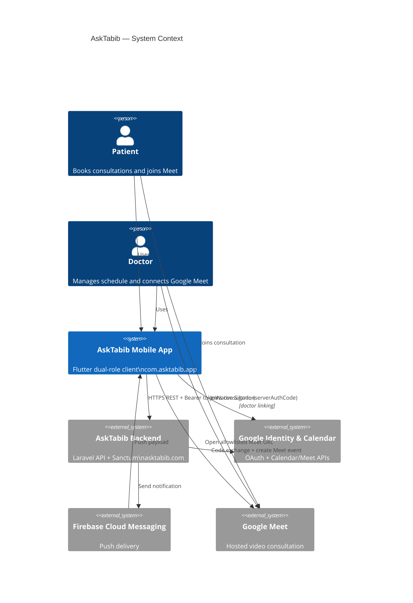
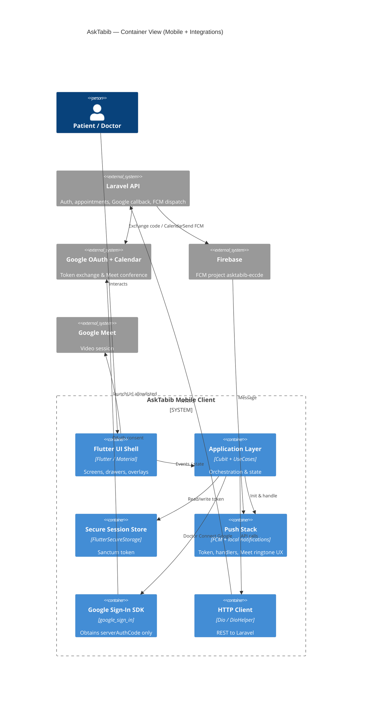
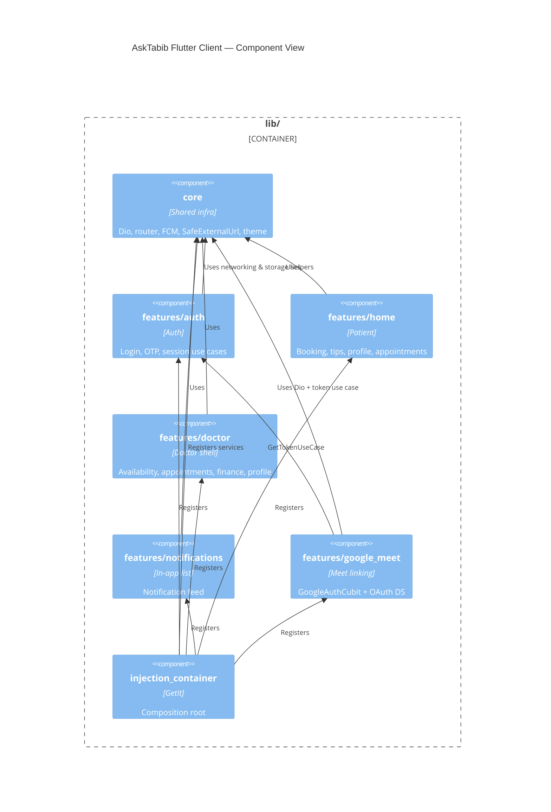
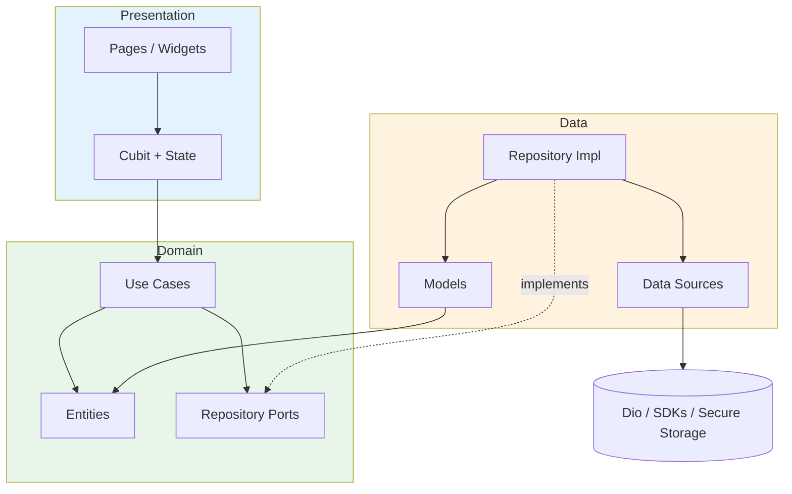
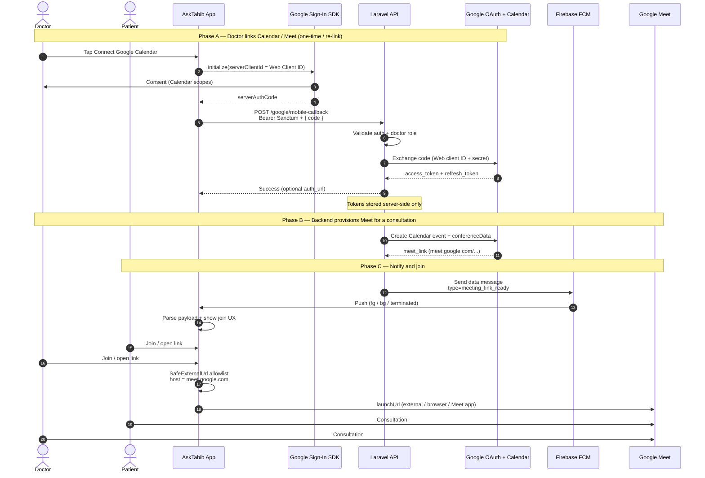
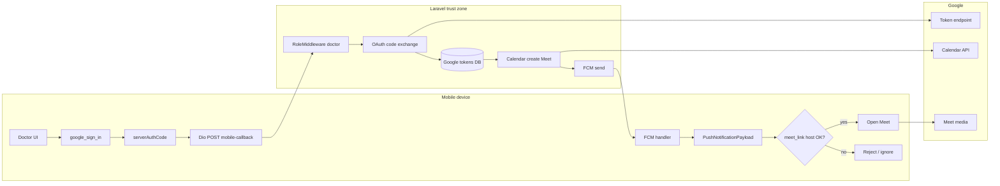
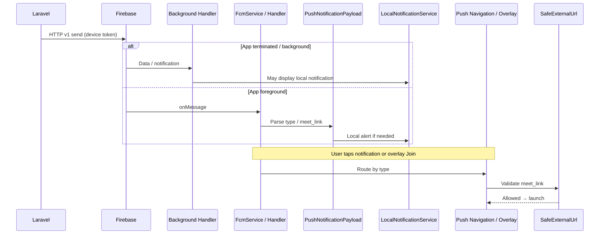
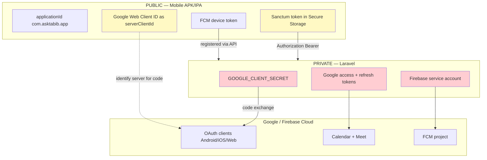
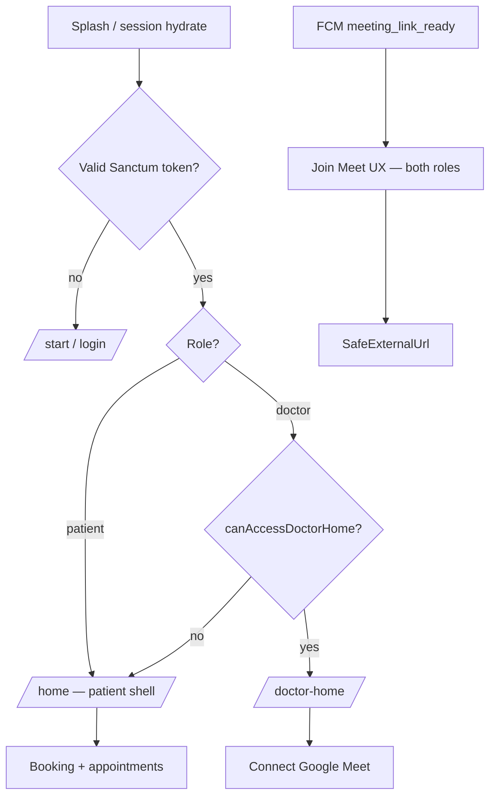

# AskTabib — Architecture Diagrams Report

| Field | Value |
|-------|--------|
| **Document type** | Architecture views (diagram pack) |
| **Companion AD** | [`ARCHITECTURE_REPORT.md`](./ARCHITECTURE_REPORT.md) |
| **Standards** | ISO/IEC/IEEE 42010 viewpoints · C4 model · UML-style sequence (Mermaid) |
| **Audience** | Architects, senior engineers, onboarding, design reviews |
| **Rendering** | Mermaid (GitHub / VS Code / most Markdown previewers) |

---

## How to use this pack

| Priority | Diagram | Why it is “strong” |
|----------|---------|---------------------|
| **P0 (primary)** | **D5 — Google Meet end-to-end** | Highest business-critical integration: OAuth, backend tokens, Calendar Meet, FCM, safe join |
| P1 | D1 System Context | Onboarding & stakeholder alignment |
| P1 | D2 Containers | Deployment / integration clarity |
| P1 | D7 Trust boundaries | Security reviews |
| P2 | D3 Components | Module map |
| P2 | D4 Clean Architecture | Coding standard visual |
| P2 | D6 FCM → Meet join | Notification ops |
| P3 | D8 Role routing | Dual-role navigation |

Operational knobs (client IDs, SHA-1, iOS checklists) live in [`GOOGLE_MEET_AND_NOTIFICATIONS.md`](./GOOGLE_MEET_AND_NOTIFICATIONS.md) — not duplicated here.

---

## D1. C4 System Context

**Viewpoint:** System Context (C4 L1)  
**Concern:** Who uses AskTabib and which external systems it depends on.

**Reading guide:** The app never holds the Google OAuth client secret. Meet media is hosted by Google; the app only links accounts and opens URLs.

---

## D2. C4 Container

**Viewpoint:** Container (C4 L2)  
**Concern:** Major deployable / runtime units and technology choices.

---

## D3. C4 Component (Flutter client)

**Viewpoint:** Component (C4 L3)  
**Concern:** Feature modules and shared core.

---

## D4. Clean Architecture dependency rule

**Viewpoint:** Code / layering  
**Concern:** Enforceable dependency direction for every feature.

**Rule:** arrows point **inward** toward Domain. UI never imports Dio data sources directly.

---

## D5. Google Meet end-to-end mechanism (PRIMARY)

**Viewpoint:** Dynamic / sequence (highest-value diagram)  
**Concern:** How a consultation becomes a joinable Google Meet — from doctor linking through push to safe open.

This is the **primary diagram** of the pack: it unifies OAuth, backend authority, Calendar Meet provisioning, FCM, and client URL policy.

### D5 — companion flowchart (control & trust)

**Invariants encoded by D5**

1. `serverAuthCode` is ephemeral; long-lived Google tokens live only on Laravel.  
2. Non-doctor callers receive API **403**.  
3. Join path never trusts arbitrary URLs — only allowlisted Meet hosts.  
4. FCM project and OAuth project are separate cloud projects (see ops doc).

---

## D6. FCM push and Meet join

**Viewpoint:** Dynamic (notifications)  
**Concern:** Lifecycle of a meeting-ready push inside the app.

**Typical data keys:** `type = meeting_link_ready`, `meet_link = https://meet.google.com/...`

---

## D7. Trust boundaries & secret placement

**Viewpoint:** Security / deployment  
**Concern:** Where secrets and tokens are allowed to exist.

| Artifact | Allowed on device? |
|----------|-------------------|
| Google Web Client ID (`serverClientId`) | Yes (public identifier) |
| Google Client Secret | **No** |
| Google refresh token | **No** |
| Sanctum bearer token | Yes (secure storage only) |
| Firebase service account JSON | **No** |

---

## D8. Dual-role navigation (supporting)

**Viewpoint:** Application behavior  
**Concern:** Patient vs doctor shell after auth.

---

## Diagram index (quick reference)

| ID | Title | C4 / kind | Priority |
|----|-------|-----------|----------|
| D1 | System Context | C4 L1 | P1 |
| D2 | Containers | C4 L2 | P1 |
| D3 | Flutter components | C4 L3 | P2 |
| D4 | Clean Architecture layers | Structural | P2 |
| **D5** | **Google Meet end-to-end** | **Sequence + control** | **P0** |
| D6 | FCM → Meet join | Sequence | P2 |
| D7 | Trust & secrets | Security | P1 |
| D8 | Role routing | Behavioral | P3 |

---

## Maintenance rule

When any of the following change, update **D5** (and usually D1/D2/D7) in the same change set:

- OAuth callback path or payload  
- Meet provisioning ownership (who creates the link)  
- FCM meeting payload contract  
- Allowlisted hosts for Meet / media  
- Application id / OAuth client binding

---

## Document control

| Version | Date | Notes |
|---------|------|-------|
| 1.0 | 2026-10-16 | Initial diagram pack; D5 designated primary (Google Meet mechanism) |
