# AskTabib Admin — Architecture Diagrams

| Field | Value |
|--------|--------|
| **System** | AskTabib Admin Dashboard |
| **Notation** | Mermaid (C4-inspired + sequence + deployment) |
| **Companion** | [architecture-report.md](../Web-Admin-Architecture.md) |
| **Date** | 16 October 2026 |
| **How to read** | Render in GitHub, VS Code Mermaid preview, or any Mermaid-capable viewer |

This pack holds the **highest-leverage** views only: context, containers, frontend structure, auth, FCM, HTTP contract, deployment, and CI. Detail text lives in the architecture report.

---

## D1 — System context (C4 Level 1)

Who uses the admin console, and which external systems it depends on.

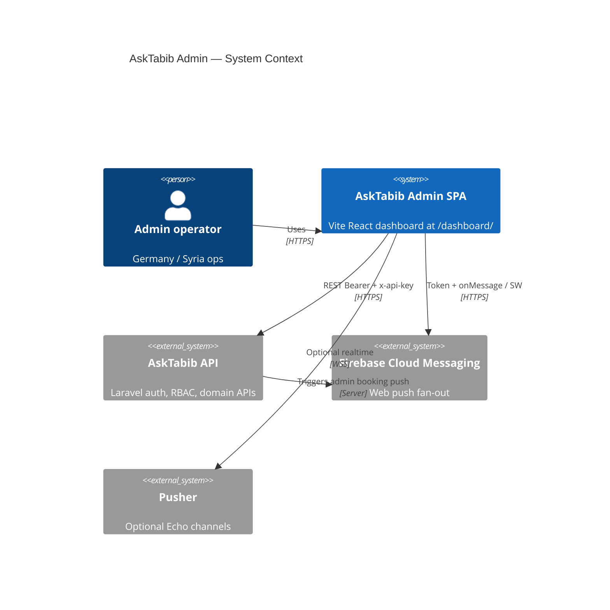

If the C4 plugin is unavailable in your viewer, use this equivalent:

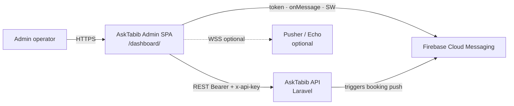

---

## D2 — Container view (C4 Level 2)

Deployable and runtime units inside the admin boundary.

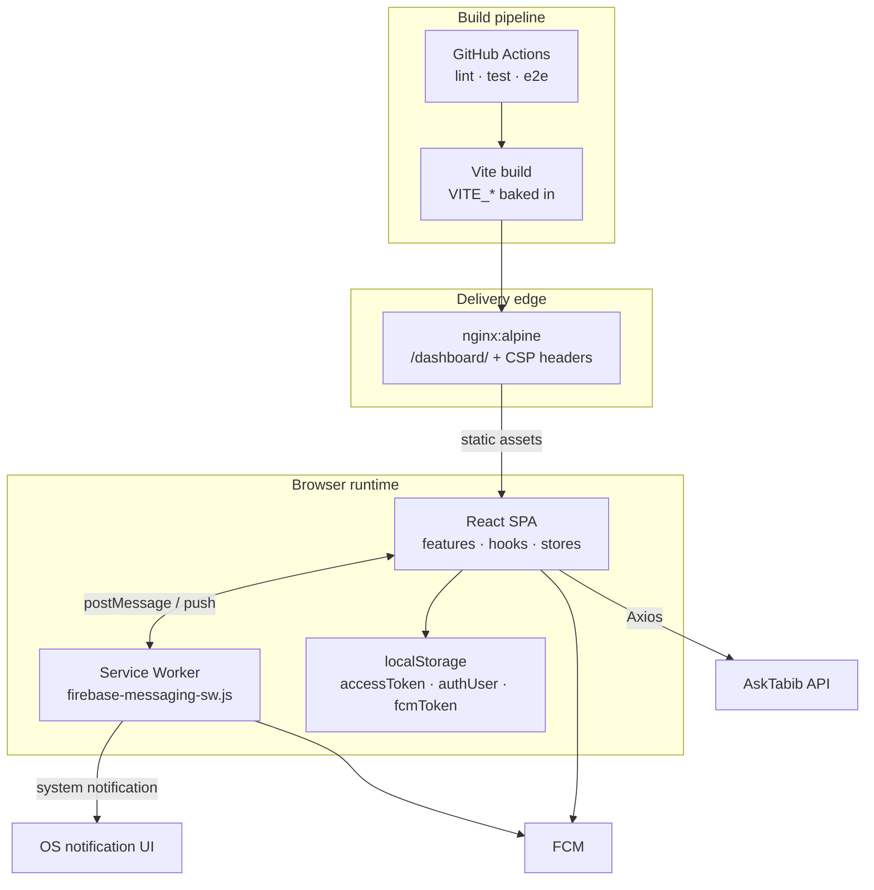

---

## D3 — Frontend layered structure

Internal layering of the SPA (strongest map for onboarding and reviews).

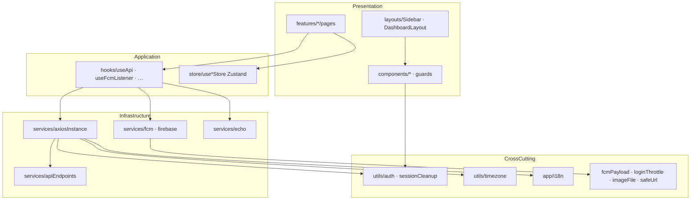

---

## D4 — Feature and route map

Domain modules and how they hang off the router.

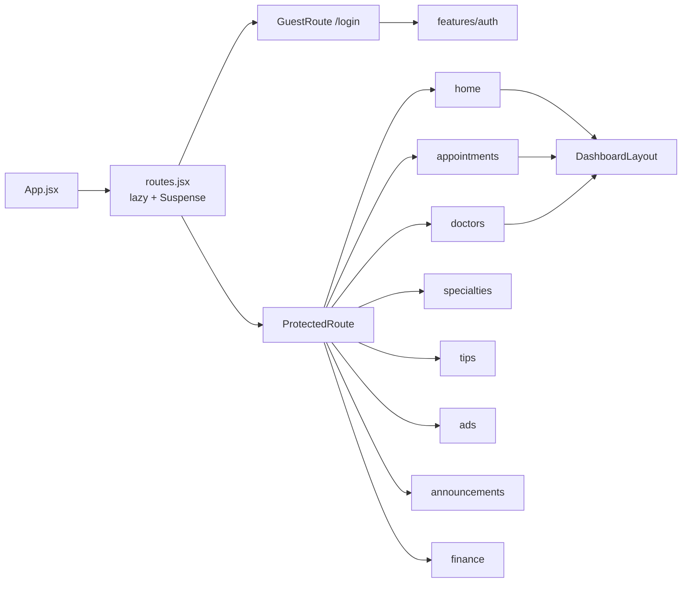

---

## D5 — Admin authentication sequence

The admission path that prevents non-admin 403 loops.

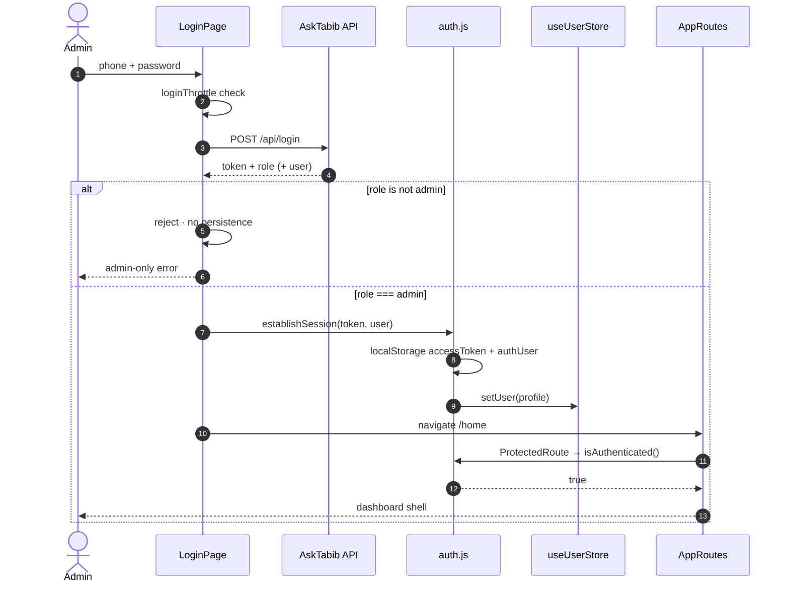

---

## D6 — FCM booking alert sequence (strongest realtime view)

Foreground and background paths for `admin_booking_received`.

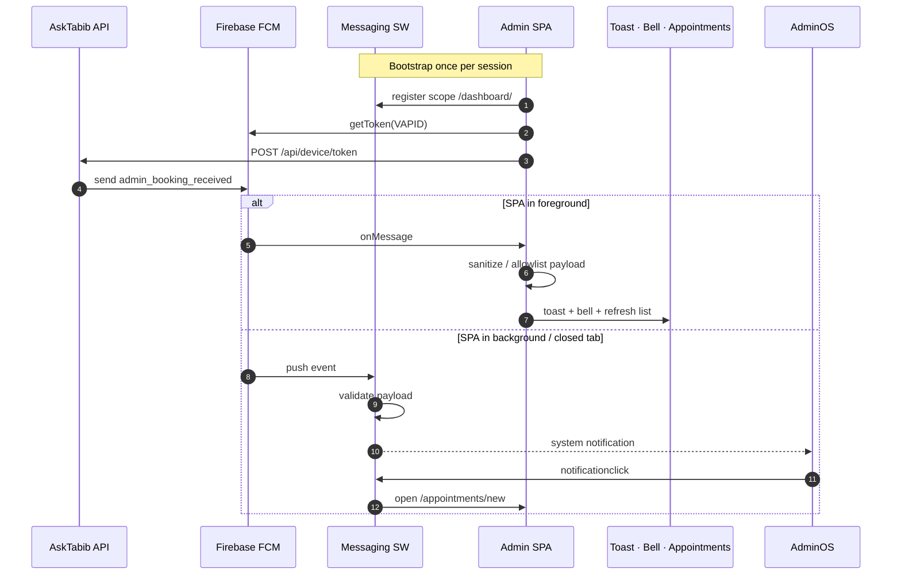

---

## D7 — HTTP request contract (interceptor pipeline)

Every authenticated call inherits the same headers and query contract.

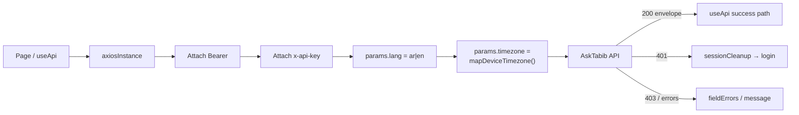

Timezone mapping (inline decision table):

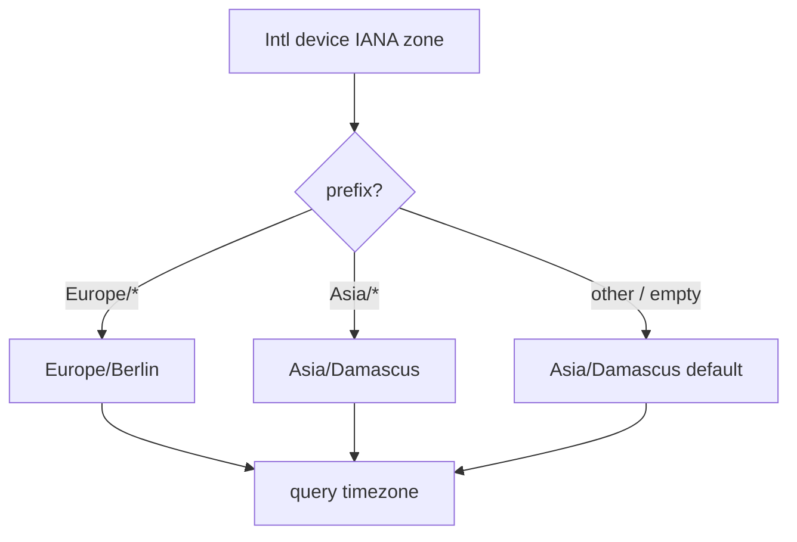

---

## D8 — Deployment topology

From CI to browser edge.

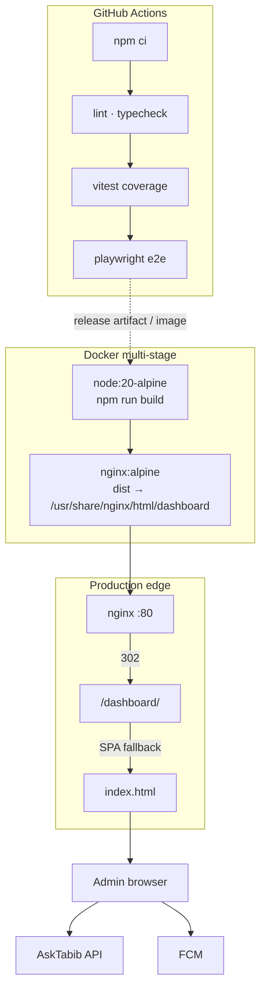

---

## D9 — Security trust boundaries

Where trust starts and stops (use in security reviews).

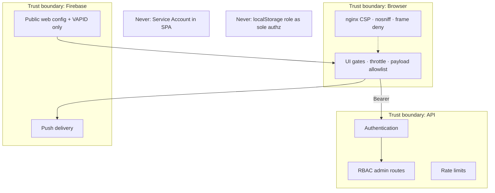

---

## D10 — Quality pipeline

How confidence is produced before merge.

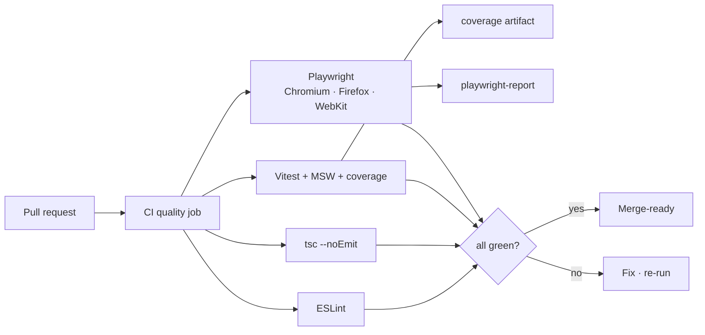

---

## Index — when to use which diagram

| ID | Use when… |
|----|-----------|
| **D1** | Explaining the product to stakeholders or new engineers |
| **D2** | Discussing hosting, SW, or env boundaries |
| **D3** | Code reviews / “where does this change go?” |
| **D4** | Adding a feature module or route |
| **D5** | Debugging login, role, or session bugs |
| **D6** | Debugging push / booking alert latency |
| **D7** | API contract or timezone / lang mismatches |
| **D8** | Docker, nginx, or release discussions |
| **D9** | Security review or threat modelling |
| **D10** | CI failures or test-strategy decisions |

---

## Maintenance

Update a diagram in the same PR that changes the behaviour it describes. Prefer editing Mermaid here over attaching binary images so the diagrams stay reviewable in git.
